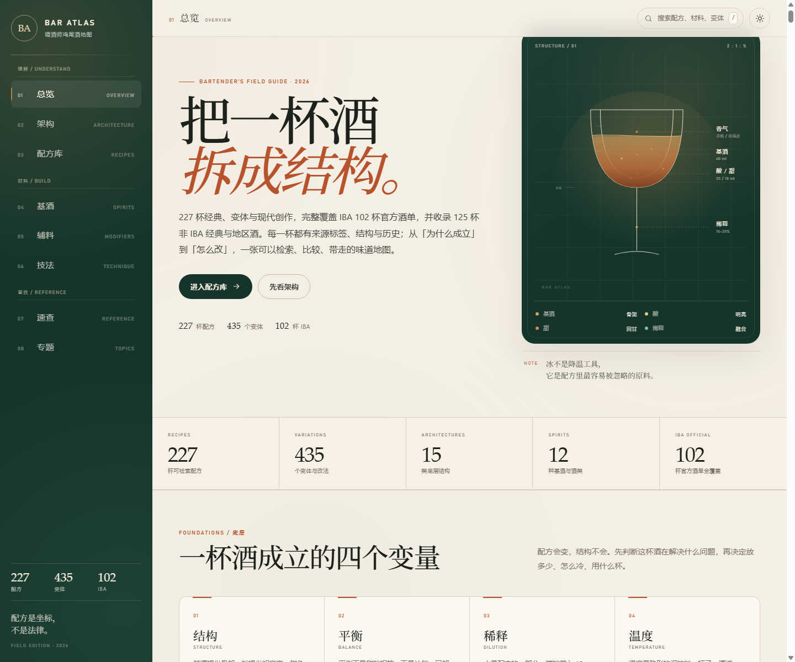

# BAR ATLAS · 调酒师鸡尾酒地图

在线版：<https://mh12332.github.io/bar-atlas/>



一个离线可用的单文件鸡尾酒知识库，面向调酒师、酒吧从业者与认真喝酒的人。样式、脚本与数据全部内联在一个 HTML 里，双击即可打开，不需要服务器，也不需要联网。

## 内容

- **227 杯配方 / 435 个变体**
- **102 杯 IBA 酒单**：官方规格优先，未取得逐项官方规格的收录款明确标注为“吧台版”
- **15 类鸡尾酒架构**：五层分析模型、家族矩阵、结构网络、历史脉络
- **12 个基酒详情页 / 87 个子类别**：威士忌、龙舌兰/梅斯卡尔、金酒、朗姆等按子类别展开，每个子类别附工艺与陈年要求、风味坐标、常见瓶与常见误区
- **32 类酒款速查 / 9 个家族**：按家族分组的风格卡片，每类给出酒精度、相对价格档、风味标签、常用瓶、可直接打开的经典配方、换瓶方向与选购提示；支持全字段搜索与家族筛选，可切换五列密集对照表
- **216 种规范材料**：从全部配方反推，合并同义写法，附类别、使用次数、用途与品牌示例
- **7 个系统化专题矩阵**：酸酒公式、换基酒、苦甜三角、气泡与稀释、温度与质地、低酒精、经典再发明
- **关系图谱**：227 个配方节点、335 条关系，支持搜索定位、自动聚焦、手动缩放与拖拽

## 使用

直接打开 `bar-atlas.html`。也可以访问在线版，或打开 `index.html` 由入口页跳转。

## 构建

```bash
python build.py
```

构建脚本按 `build.py` 里的顺序把 `src/` 下的样式、数据与脚本内联进 `bar-atlas.html`，并写入版本信息。**不要手改 `bar-atlas.html`**，它每次构建都会被整体覆盖。

## 目录

```text
bar-atlas.html         生成后的单文件网站（构建产物，勿手改）
index.html             跳转到 bar-atlas.html 的入口页
.nojekyll              GitHub Pages 配置，禁用 Jekyll
build.py               构建脚本
VERSION                当前版本号（语义化版本，构建时注入页面）
CHANGELOG.md           版本更新记录
LICENSE                许可协议（CC BY-NC 4.0）
package.json           检查脚本入口（无第三方依赖）
.editorconfig          缩进、换行与编码约定
.gitattributes         换行符与二进制文件规则
preview.png            首屏预览
README.md              本文件
src/
  shell.html           页面结构
  styles.css           样式与响应式布局
  app.js               交互与渲染
  data-*.js            配方、材料、关系、专题等数据
  validate.js          数据校验
  browser-check.mjs    Chrome DevTools 浏览器测试
```

以下目录由测试自动生成，不参与构建，已被 `.gitignore` 忽略：

```text
shots/                 浏览器测试截图与 report.json
.chrome-check/         浏览器测试的临时 Chrome 配置
```

## 开发检查

```bash
npm run validate       # 数据一致性校验
npm run check:browser  # 无头浏览器逐屏检查（需要本机 Chrome）
npm run check          # 上面两条一起跑
```

`validate.js` 校验配方、材料与图谱数据的一致性；`browser-check.mjs` 会启动无头浏览器逐屏检查并输出截图到 `shots/`，退出码非 0 或有 `errors` 时不要发布。脚本本身无第三方依赖，只用 Node 内置模块。

代码风格约定写在 `.editorconfig` 里（2 空格缩进、LF 换行、UTF-8、文件以换行结尾），提交前请让编辑器按它保存；仓库里没有格式化工具，也不跑自动重排。

## 版本与更新记录

- 版本号只写在根目录的 `VERSION` 文件里，不要在页面或脚本里另抄一份。
- `python build.py` 会把版本号与构建信息注入 `bar-atlas.html`：输出 `<meta name="bar-atlas-version">`、`<meta name="bar-atlas-build">`，并在页脚显示 `vX.Y.Z`（悬停可看构建信息）。
- 每次发布：在 `CHANGELOG.md` 补一段记录 → 更新 `VERSION` → 重新构建 → 提交并打 `vX.Y.Z` 标签。

变更记录见 [CHANGELOG.md](CHANGELOG.md)。

## 数据与准确性说明

- IBA 索引按官方三类酒单整理；官方逐项规格可核的配方优先展示官方比例。
- 暂未取得逐项官方规格的 IBA 收录款标注为“IBA 收录 · 吧台版”，不冒充官方配方。
- 历史与来源信息尽量标注出处；不同资料存在版本差异时，以“常见记载 / 经典文献”而非确定事实呈现。
- 品牌仅作为类别示例，不是商业推荐。

## 许可

除另有说明外，本仓库的全部内容——配方整理、架构分析、文本、图表，以及构建脚本与页面代码——采用 [CC BY-NC 4.0](LICENSE) 许可：

- **署名**：转载或改编时请注明来源 BAR ATLAS 与在线地址。
- **非商业**：不得用于商业目的；商业使用需另行取得授权。
- **改编**：允许修改与再分发，但需保留同样的许可并说明改动。

© 2026 BAR ATLAS
